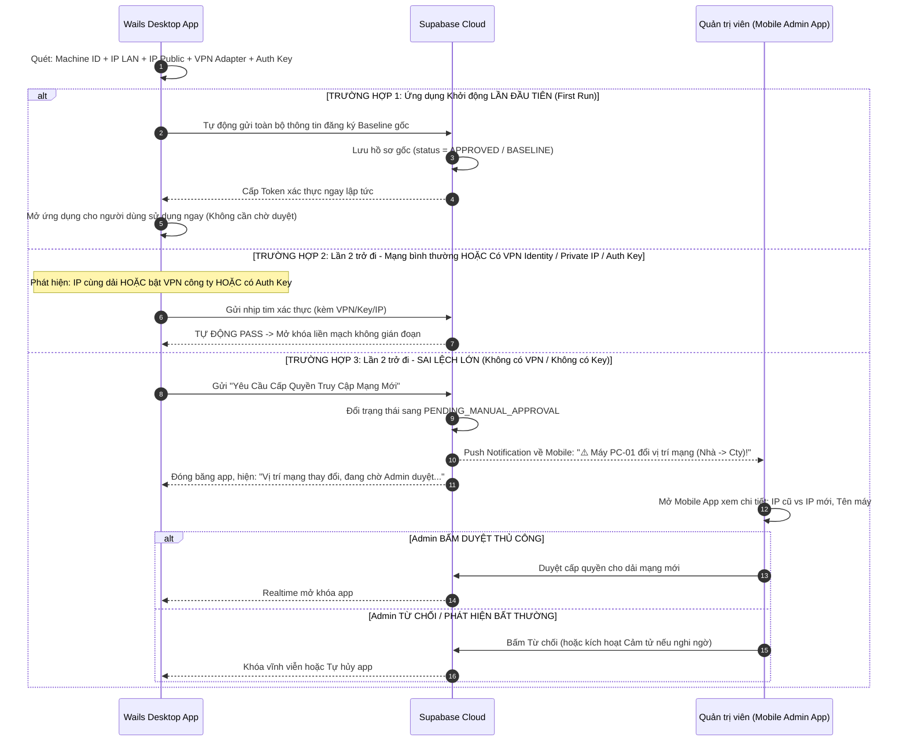
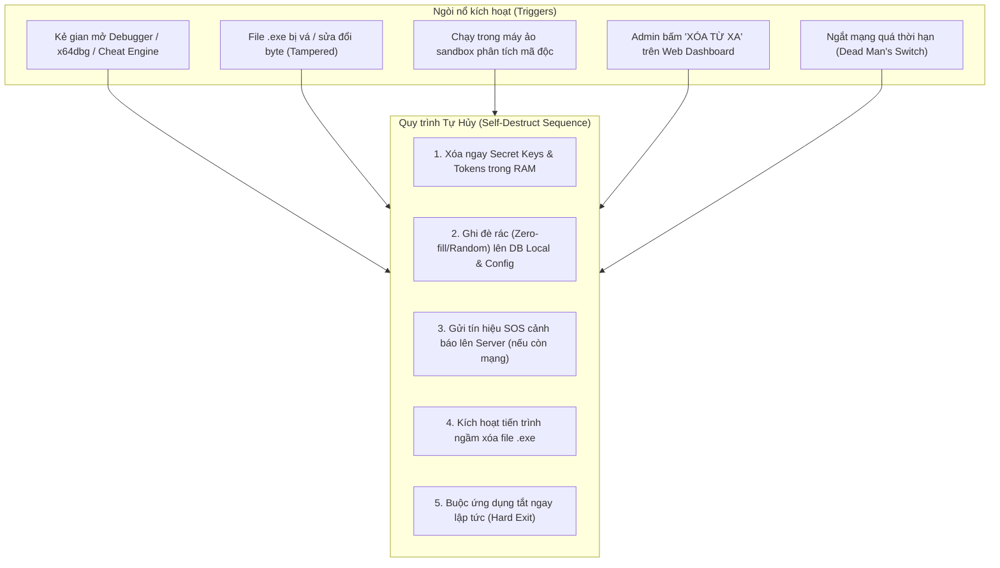
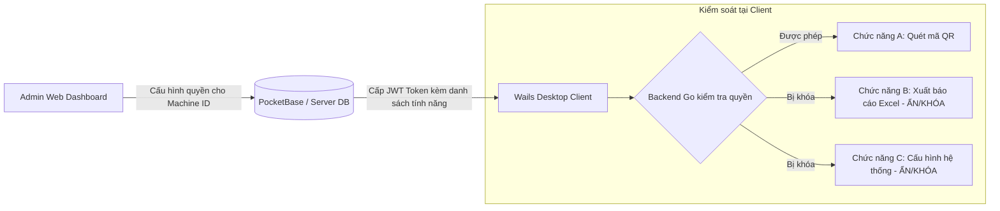
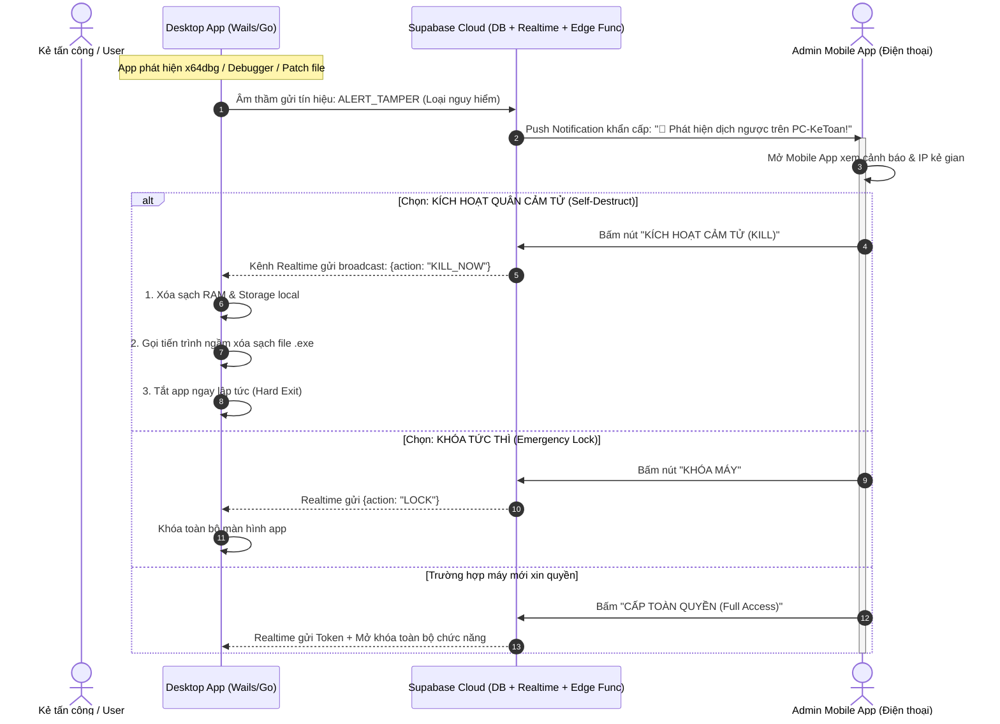

# Đề xuất & Kế hoạch Triển khai: Quản lý & Phê duyệt Quyền Sử dụng Ứng dụng (Machine ID & IP)

Tài liệu này tổng hợp ý tưởng, kiến trúc luồng hoạt động và đề xuất giải pháp máy chủ cho tính năng **xác thực & xét duyệt quyền sử dụng ứng dụng theo thiết bị và địa chỉ IP**.

---

## 1. Lưu ý Cốt lõi về Bản chất "IP" & Cơ Chế Dung Sai Mạng (Network Tolerance)

Hệ thống được thiết kế theo hướng **thực tế và linh hoạt (không quá khắt khe gây ức chế cho người dùng)**, nhưng vẫn chặn đứng các hành vi gian lận hoặc mang ứng dụng sang môi trường lạ:

1. **Phân biệt IP Động (DHCP) & Cơ chế Dung sai dải mạng (Subnet Tolerance):**
   - **Mạng gia đình / Cá nhân & IP Động:** Modem mạng cá nhân hoặc Wi-Fi thường xuyên đổi IP mỗi khi tắt mở modem (IP Động). Nếu mỗi lần đổi một số đuôi IP mà bắt người dùng xin duyệt thì ứng dụng sẽ rất khó chịu.
   - **Quy tắc Dung sai (Tolerance):** Nếu IP thay đổi nhưng **vẫn nằm trong cùng dải phân phát của mạng đó** (ví dụ cùng Subnet `/24` nội bộ từ `192.168.1.15` sang `192.168.1.80`, hoặc dải IP Public cùng cụm nhà mạng) -> **Hệ thống tự động PASS**, cho phép sử dụng bình thường mà không cần gửi yêu cầu.
2. **Khi nào MỚI XÁC ĐỊNH LÀ "SAI LỆCH QUÁ NHIỀU" (Major Deviation)?**
   - **Di chuyển vị trí thực tế (Nhà <--> Công ty):** Ví dụ dải IP ở công ty là `192.168.1.x`, khi nhân viên mang máy về nhà hoặc di chuyển ra ngoài xuất hiện dải IP mới `186.152.x.x` (hoặc dải IP Public hoàn toàn khác tỉnh/khác nhà mạng).
   - **Thay đổi nơi ở / Sang mạng lạ:** Kết nối vào mạng Wi-Fi công cộng, phát 4G từ điện thoại lạ, hoặc chuyển nhà.
   - **Thay đổi định danh máy:** Tên máy tính (`Hostname`) hoặc `Windows Username` bị thay đổi so với hồ sơ gốc ban đầu.
   - 👉 **Hành động:** Khi phát hiện sai lệch lớn vượt ngoài ngưỡng cho phép, app mới lập tức chặn lại và kích hoạt cơ chế kiểm tra (hoặc xin duyệt).

3. **Cơ Chế Nhận Diện Miễn Duyệt Liền Mạch (Bypass - Tránh Gây Ức Chế Cho Người Dùng):**
   Để người dùng hợp lệ không cảm thấy phiền phức khi di chuyển linh hoạt (Work from Home, đi công tác), hệ thống hỗ trợ 3 "tấm vé thông hành đặc cách" giúp tự động PASS:
   - **Nhận diện VPN Identity (Tailscale / WireGuard / OpenVPN):**
     - App tự động quét danh sách card mạng ảo (Virtual Adapters: `tailscale0`, `wg0`, `tun0`, TAP Adapter).
     - Nếu phát hiện máy đang kết nối qua VPN nội bộ của công ty và sở hữu địa chỉ **Private IP của VPN** (ví dụ `100.64.x.x` của Tailscale hoặc `10.8.0.x` của WireGuard) -> **TỰ ĐỘNG PASS 100% NGAY LẬP TỨC**. Dù người dùng ở nhà, quán cafe hay phát 4G, chỉ cần bật VPN là dùng mượt mà, không bao giờ bị chặn.
   - **Private IP Whitelist (Dải mạng riêng nội bộ tin cậy):**
     - Cho phép định nghĩa sẵn danh sách các dải Private IP tin cậy (ví dụ: Văn phòng chính `192.168.1.0/24`, Chi nhánh 1 `10.0.1.0/24`, Chi nhánh 2 `172.16.0.0/16`).
     - Khi nhân viên mang laptop di chuyển giữa các chi nhánh hoặc phòng ban trong công ty, IP nội bộ vẫn thuộc dải Private IP này -> **Tự động PASS**.
   - **Authentication Key (Khóa Ủy Quyền / Roaming Bypass Key):**
     - Đối với lãnh đạo, nhân sự cấp cao hoặc nhân viên hay đi thị trường: Admin cấp 1 **Authentication Key** (chuỗi mã hóa hoặc QR Code có hạn dùng, ví dụ 30 ngày hoặc vĩnh viễn).
     - Khi đổi sang mạng lạ, nếu có Auth Key hợp lệ, app tự động thông qua mà không cần chờ Admin online để bấm duyệt trên điện thoại.

---

## 2. Kiến trúc & Luồng Hoạt động (Lần đầu mở App vs Lần thứ 2 trở đi)

> [!NOTE]
> **Nguyên tắc Vận Hành Tối Ưu:**
> - **Lần đầu tiên mở app:** KHÔNG cần gửi request xin phép hay chờ duyệt. Ứng dụng tự động thu thập thông tin gốc gửi thẳng lên máy chủ để tạo **Hồ sơ gốc (Baseline Profile)** và cho phép người dùng vào dùng ngay.
> - **Lần thứ 2 trở đi:** Ứng dụng tự động kiểm tra:
>   - Nếu mạng bình thường (IP ở nhà, IP động cùng dải): **Tự động PASS**.
>   - Nếu phát hiện có **VPN Identity hợp lệ** HOẶC **Private IP thuộc Whitelist** HOẶC **có Authentication Key**: **Tự động PASS liền mạch (Không gây ức chế)**.
>   - Nếu phát hiện **sai lệch lớn** (đổi vị trí Nhà <-> Công ty mà không có VPN/Key, đổi tên máy): Bắt buộc gửi yêu cầu truy cập và **Admin duyệt thủ công trên Mobile**.



### Các bước xác thực kỹ thuật:
1. **Lần đầu tiên mở app (Zero-Friction Baseline):**
   - Tầng Go lấy: `Machine UUID`, `Computer Name`, `Windows Username`, `Local LAN IP`, `Subnet Mask`, `IP Public`.
   - Gửi payload lên Supabase lưu vào bảng `devices` với `status: 'APPROVED'` và gán dải mạng này là `baseline_network`.
   - Người dùng bắt đầu làm việc ngay, không bị gián đoạn.
2. **Kiểm tra dung sai từ lần thứ 2 (Drift & Tolerance Calculation):**
   - Khi khởi động lại app hoặc mỗi lần gửi Heartbeat:
     - So sánh `Local IP` với `baseline_local_ip` theo Subnet Mask (ví dụ: `192.168.1.15` và `192.168.1.80` đều thuộc mạng `192.168.1.0/24` -> Hợp lệ).
     - So sánh dải `Public IP`.
   - **Kích hoạt gửi Yêu cầu duyệt:**
     - Nếu phát hiện nhảy mạng: từ IP văn phòng (`192.168.1.x`) sang mạng cá nhân (`186.152.x.x`), hoặc chuyển từ nhà lên công ty.
     - Nếu phát hiện đổi Tên máy tính hoặc User Windows.
     - App ngưng hoạt động, phát lệnh yêu cầu duyệt thủ công lên Supabase.
3. **Quản trị viên duyệt thủ công trên điện thoại:**
   - Admin nhìn thấy rõ: *"Máy Kế Toán chuyển từ vị trí Mạng A sang Mạng B"*.
   - Admin bấm **"Chấp nhận vị trí mạng mới"** -> App được mở khóa tiếp tục.


---

## 3. Đề xuất Công nghệ Máy chủ (Backend Stack)

| Phương án | Bản chất & Công nghệ | Ưu điểm & Điểm mạnh khi kết nối Mobile | Đánh giá |
| :--- | :--- | :--- | :--- |
| **Phương án 1: Supabase (BaaS Cloud)** *(Khuyên dùng số 1 khi có Mobile App)* | Nền tảng Cloud BaaS dựa trên **PostgreSQL**, tích hợp sẵn Realtime WebSockets, Auth, RLS và Edge Functions. | - **Có sẵn SDK chuẩn cho Mobile** (Flutter, React Native, Swift, Kotlin) giúp code App Mobile cực nhanh.<br>- **Supabase Realtime**: Admin bấm nút trên Mobile, Desktop nhận lệnh đổi trạng thái hoặc lệnh tự hủy chỉ sau 50 - 100ms.<br>- **Edge Functions & Webhooks**: Tự động bắn Push Notification (FCM/OneSignal) về điện thoại của Admin khi phát hiện có kẻ dịch ngược/debug.<br>- **Miễn phí (Free Tier)** cực lớn: 500MB DB, 200 Realtime connections, hoàn toàn không tốn tiền server. | ⭐⭐⭐⭐⭐ **LỰA CHỌN TỐT NHẤT** (Khi có kế hoạch làm App Mobile quản trị) |
| **Phương án 2: PocketBase** | Viết bằng **Go**, đóng gói thành **1 file binary duy nhất** (`pocketbase.exe` hoặc Linux binary) kèm sẵn SQLite. | - Thích hợp nếu chỉ muốn Web Admin UI sẵn có trên trình duyệt mà không muốn tự viết ứng dụng Mobile.<br>- Cực nhẹ, tự lưu trữ (Self-hosted) nội bộ. | ⭐⭐⭐⭐ Phù hợp nếu chỉ quản lý qua Web PC |
| **Phương án 3: Tự viết REST API** | Viết custom service bằng **Go (Fiber / Gin)** + PostgreSQL / SQLite. | - Tự chủ 100% nhưng tốn nhiều thời gian code API, WebSocket, cơ chế Push Notification cho Mobile. | ⭐⭐⭐ Tốn nhiều công sức bảo trì |


---

## 4. Đề xuất Hạ tầng & Nơi Đặt Máy Chủ (Hosting)

| Loại hạ tầng | Lựa chọn đề xuất | Chi phí ước tính | Phù hợp khi nào |
| :--- | :--- | :--- | :--- |
| **Cloud PaaS (Tiện lợi)** | **Render.com / Railway.app / Fly.io** | Miễn phí hoặc ~$5/tháng | Triển khai nhanh trong vài phút, không cần cấu hình Linux/VPS phức tạp. |
| **VPS Cloud Quốc tế** | **Hetzner / DigitalOcean / Vultr** | ~$4 - $6/tháng | Cần hệ thống ổn định lâu dài, có IP tĩnh riêng. |
| **Cloud trong nước** | **Vietnix / BKNS / Viettel IDC** | ~100k - 150k VNĐ/tháng | Tối ưu đường truyền trong nước, ping cực thấp cho người dùng tại Việt Nam. |
| **Server nội bộ (On-Premise)** | 1 máy PC / Mini PC tại văn phòng | Miễn phí (tận dụng máy sẵn có) | Ứng dụng chỉ sử dụng nội bộ qua mạng LAN văn phòng hoặc VPN công ty. |

---

## 5. Cơ chế Bảo mật & Chống Gian lận (Security)

1. **Xác thực từ phía Máy chủ (Server-side Validation):**
   - Không chỉ chặn ở giao diện khởi động app. Mọi API nghiệp vụ quan trọng mà app gọi tới đều phải kèm theo **Token (JWT)** do máy chủ cấp sau khi đã duyệt thiết bị.
2. **Cơ chế Heartbeat (Nhịp tim định kỳ):**
   - Trong quá trình app đang chạy, định kỳ mỗi 5 - 15 phút app gửi 1 request ping nhẹ về server.
   - Nếu Admin đổi trạng thái sang `BLOCKED`, app sẽ tự động thu hồi phiên làm việc và khóa màn hình ngay lập tức.
3. **Ký số payload (HMAC Signature):**
   - Gói tin handshake gửi từ client lên server có thể được hash kèm 1 secret key để chống việc dùng Postman/curl giả mạo gửi request.

---

## 6. Cơ Chế "Quân Cảm Tử" (Self-Destruct) & Lệnh Xóa Ứng Dụng Từ Xa (Remote Kill)

Đây là cơ chế chủ động tự hủy nhằm bảo vệ dữ liệu nhạy cảm, thuật toán và mã nguồn khi thiết bị bị chiếm quyền kiểm soát hoặc phát hiện có kẻ cố tình dịch ngược, debug ứng dụng.



### 6.1. Hai hình thức kích hoạt tự hủy:

1. **Tự hủy chủ động từ Quản trị viên (Remote Kill Command):**
   - Admin thấy máy có dấu hiệu rò rỉ hoặc nghi ngờ nhân viên mang máy ra ngoài -> Bấm nút **"Thu hồi & Tự hủy" (Wipe & Destroy)** trên Dashboard.
   - Nhờ kênh **Realtime (WebSocket / SSE)** hoặc **Heartbeat**, app nhận lệnh ngay lập tức và tiến hành tự xóa sổ.
2. **Tự hủy tự động nội tại (Local Triggered Suicide - "Bẫy cảm tử"):**
   - App phát hiện đang bị gắn Debugger (x64dbg, OllyDbg, IDA Pro, Wireshark).
   - App kiểm tra chữ ký/hash của chính mình, phát hiện binary đã bị sửa đổi (Patching).
   - Không cần chờ lệnh server, app tự động kích hoạt tiến trình tự hủy ngay trong tích tắc.
3. **Dead Man's Switch (Hạn ngạch mất mạng offline):**
   - Nếu kẻ tấn công cố tình ngắt mạng máy tính (Air-gapped) để server không gửi được lệnh Remote Kill: App áp dụng cơ chế đếm ngược. Nếu quá **X giờ** (ví dụ 12 giờ hoặc 24 giờ) mà app không kết nối được về Server để gia hạn giấy phép, ứng dụng sẽ tự động khóa vĩnh viễn và xóa sạch token/dữ liệu cache.

### 6.2. Kỹ thuật tự xóa file `.exe` trên hệ điều hành Windows:
> **Vấn đề trên Windows:** Một file `.exe` đang chạy sẽ bị Windows khóa (Lock file), không thể gọi lệnh `os.Remove()` để xóa chính nó được.
>
> **Giải pháp kỹ thuật (Self-Delete Drop-in):**
> 1. Khi kích hoạt tự hủy, ứng dụng Go chạy một tiến trình con độc lập chạy ngầm (PowerShell hoặc Batch script ẩn không hiện cửa sổ console).
> 2. Đoạn script này đợi 1 - 2 giây cho tiến trình `.exe` chính tắt hẳn:
>    ```bat
>    @echo off
>    timeout /t 1 /nobreak > NUL
>    del /f /q "app.exe"
>    del /f /q /s "AppData\Local\YourApp\*"
>    del /f /q "%~f0"
>    ```
>    *(Script xóa file `app.exe`, xóa thư mục dữ liệu tạm, và tự xóa chính file `.bat` này)*.
> 3. Tầng Go gọi lệnh `os.Exit(0)` để giải phóng lock file, script ngầm sẽ dọn dẹp sạch sẽ không để lại dấu vết.

---

## 7. Chống Dịch Ngược & Bảo Vệ Mã Nguồn (Anti-Reverse Engineering)

Mặc dù Go là ngôn ngữ biên dịch ra mã máy native (.exe) khó dịch ngược hơn C#, Java hay Python, nhưng kẻ gian vẫn có thể dùng các công cụ như IDA Pro, Ghidra, GoReSym để đọc tên hàm, chuỗi kết nối và API endpoint. Cần kết hợp các giải pháp sau:

### 7.1. Chống dịch ngược tầng Backend (Go):
1. **Xóa toàn bộ ký hiệu debug và symbol table:**
   - Khi build ứng dụng cho người dùng, bắt buộc dùng cờ build:
     ```bash
     go build -ldflags="-s -w" -trimpath
     ```
     - `-s`: Xóa thông tin symbol table.
     - `-w`: Xóa thông tin debug DWARF (giảm dung lượng file và khiến decompiler mất tên hàm, dòng code).
     - `-trimpath`: Xóa sạch đường dẫn thư mục code trên máy lập trình viên (không để lộ tên ổ đĩa, username tác giả).
2. **Làm rối mã nguồn nâng cao (Code Obfuscation với Garble):**
   - Thay vì dùng `go build` tiêu chuẩn, sử dụng công cụ chuyên dụng **Garble**:
     ```bash
     garble -literals -tiny build
     ```
     - Tự động mã hóa toàn bộ chuỗi ký tự (String Literals) thành các mảng byte biến đổi, khiến kẻ phân tích mở file lên bằng Notepad/Hex Editor/Strings không đọc được URL API hay Token bí mật.
     - Đổi toàn bộ tên hàm, tên package, tên biến thành chuỗi ngẫu nhiên vô nghĩa (ví dụ `UserLogin` -> `aZb19c`).
3. **Phát hiện Debugger (Anti-Debugging API):**
   - Dùng Windows API để kiểm tra ứng dụng có đang bị gắn cờ giám sát:
     - `IsDebuggerPresent()`
     - `CheckRemoteDebuggerPresent()`
   - Nếu phát hiện trả về `true` -> Kích hoạt ngay kịch bản "Quân cảm tử" (Mục 6).
4. **Đóng gói bảo vệ tầng sâu (Binary Packing / Protector):**
   - Dùng các công cụ chuyên sâu như **Themida**, **VMProtect** hoặc mã nguồn mở **UPX + Anti-unpack patch** để nén và mã hóa toàn bộ file nhị phân, chống dump memory từ RAM.

### 7.2. Chống lộ mã nguồn tầng Giao diện Frontend (Wails HTML/JS):
1. **Minify & Obfuscate JS:**
   - Dùng **JavaScript-Obfuscator** để biến đổi mã JS frontend thành dạng rối (control flow flattening, string array encoding).
   - Tắt tính năng DevTools (F12 / Inspect Element) khi đóng gói phiên bản Production trong Wails (`wails build -clean`).
2. **Nguyên tắc "Zero-Trust Client" (Không tin tưởng Client):**
   - **Tuyệt đối không lưu logic tính toán sống còn hoặc Master Secret Key ở phía Client.**
   - Những nghiệp vụ quan trọng nhất phải được đặt trên Server; Client chỉ gửi tham số và nhận kết quả. Kể cả kẻ gian có dịch ngược được file client thì cũng chỉ thấy giao diện vỏ bọc chứ không lấy được "trái tim" của hệ thống.

---

## 8. Giới Hạn Hoạt Động & Phân Quyền Tính Năng Theo Từng Máy Cụ Thể

Không chỉ dừng ở việc "Cho phép" hay "Chặn", hệ thống cho phép cấu hình **ma trận tính năng (Feature Matrix / Granular Entitlements)** riêng biệt cho từng chiếc máy.



### 8.1. Cấu trúc lưu trữ quyền trên Server (Ví dụ với PocketBase):
Trong bảng `devices`, thêm trường `features` (dạng JSON Array hoặc Multi-select):
```json
{
  "machine_id": "BFEBFBFF000906EA-xxxx-yyyy",
  "device_name": "PC-KeToan-01",
  "status": "APPROVED",
  "allowed_features": [
    "FEATURE_SCAN_ONLY",
    "FEATURE_VIEW_DATA"
  ],
  "max_offline_hours": 12,
  "is_kill_signal_sent": false
}
```

### 8.2. Cơ chế thực thi 2 lớp:
1. **Lớp hiển thị giao diện (Frontend):**
   - Client sau khi đăng nhập/bắt tay sẽ nhận về danh sách tính năng được cấp phép.
   - Các nút bấm, menu của những tính năng bị cấm sẽ tự động bị **ẩn hoàn toàn** hoặc hiển thị biểu tượng ổ khóa xám.
2. **Lớp bảo vệ thực thi (Backend Go - Bắt buộc):**
   - Không được chỉ ẩn nút ở frontend (vì kẻ gian có thể mở DevTools sửa DOM để hiện nút).
   - Ở tầng Go (Wails Bindings), mỗi khi hàm nghiệp vụ được gọi từ frontend, Go sẽ kiểm tra:
     ```go
     func (a *App) ExportFinancialReport() error {
         if !a.licenseManager.HasFeature("FEATURE_EXPORT_REPORT") {
             return errors.New("tính năng này chưa được kích hoạt trên thiết bị của bạn")
         }
         // Thực hiện nghiệp vụ...
     }
     ```
   - **Xác thực qua Server:** Khi thực hiện thao tác đó, request gửi lên Server cũng mang theo Token. Server kiểm tra lại một lần nữa xem thiết bị có quyền hay không trước khi trả dữ liệu.

---

## 9. Bảng Tổng Hợp Chiến Lược Phòng Thủ Toàn Diện (Defense-in-Depth)

| Nguy cơ / Rủi ro | Giải pháp kỹ thuật áp dụng | Mức độ bảo vệ |
| :--- | :--- | :--- |
| **Chia sẻ file app sang máy khác dùng lậu** | Machine ID (Phần cứng) + Quản trị viên duyệt từng máy trên Dashboard. | ⭐⭐⭐⭐⭐ Tuyệt đối |
| **Dùng ngoài văn phòng / rò rỉ mạng** | Ràng buộc dải IP văn phòng / VPN công ty / Dải Private IP Whitelist. | ⭐⭐⭐⭐ Rất cao |
| **Nhân viên nghỉ việc / Máy bị đánh cắp** | Nút **"Remote Kill / Wipe"** từ Dashboard: Xóa dữ liệu & tự xóa file app từ xa. | ⭐⭐⭐⭐⭐ Tuyệt đối |
| **Bị mở tool dịch ngược, soi RAM, debug** | **Anti-Debug API** + **Cơ chế cảm tử (Local Suicide)**: Tự dập app và xóa file. | ⭐⭐⭐⭐ Rất cao |
| **Đọc chuỗi kết nối / Đọc trộm code** | Build cờ `-ldflags="-s -w"`, dùng **Garble Obfuscator** mã hóa literals và làm rối hàm. | ⭐⭐⭐⭐ Rất cao |
| **Decompile bóc tách thuật toán lõi** | **Cơ chế "Tách Não" (In-Memory Micro-Module)**: .exe rỗng, giải mã logic chạy thẳng trong RAM. | ⭐⭐⭐⭐⭐ Tuyệt đối |
| **Clone ổ cứng / Giả lập phần cứng máy ảo** | **Chip TPM 2.0 (Hardware Security)**: Khóa mật mã vật lý không thể sao chép ra ngoài. | ⭐⭐⭐⭐⭐ Tuyệt đối |
| **Inject DLL gian lận (Cheat Engine, Frida)** | **Windows Process Mitigation Policy**: Chặn can thiệp bộ nhớ từ cấp Kernel hệ điều hành. | ⭐⭐⭐⭐⭐ Tuyệt đối |
| **Hacker cố tình bypass logic để dịch ngược** | **Bẫy Honeypot & Đầu Độc Ngược**: Trả dữ liệu giả (Poisoning), âm thầm gửi danh tính hacker về điện thoại. | ⭐⭐⭐⭐⭐ Tuyệt đối |
| **Vá binary (Patching jnz/jmp để bẻ khóa)** | Hash kiểm tra toàn vẹn file (File Integrity Check) so khớp với chữ ký của Server. | ⭐⭐⭐⭐⭐ Tuyệt đối |
| **Sử dụng chức năng trái thẩm quyền** | Phân quyền tính năng theo từng Machine ID (Granular Feature Flags) được ký trong JWT Token. | ⭐⭐⭐⭐⭐ Tuyệt đối |
| **Ức chế vì phải chờ Admin duyệt thủ công** | **Mã QR Động (TOTP) + FaceID trên Mobile**: Quét mở khóa tức thì trong 2 giây. | ⭐⭐⭐⭐⭐ Hoàn hảo |


---

## 10. Tích Hợp Ứng Dụng Giám Sát Mobile (Mobile Admin) & Trung Tâm Tác Chiến Cảm Tử Qua Supabase

Phương án kết hợp **Supabase** với **Ứng dụng Mobile do bạn tự phát triển** (Flutter / React Native) là giải pháp hoàn hảo nhất để biến chiếc điện thoại của bạn thành một **"Trung tâm Chỉ huy Tác chiến Bỏ túi"**, giám sát thiết bị và can thiệp từ xa ở mọi lúc mọi nơi.



### 10.1. Vì sao Supabase là lựa chọn số 1 khi có Mobile App?
1. **SDK Mobile chính thức & cực kỳ mạnh:**
   - Supabase hỗ trợ SDK hoàn hảo cho **Flutter** (`supabase_flutter`) hoặc **React Native**, giúp bạn làm ứng dụng mobile quản trị chỉ trong 1 - 2 ngày mà không phải tự thiết kế hệ thống API backend phức tạp.
2. **Kênh Realtime (WebSockets) siêu tốc:**
   - Sử dụng công nghệ **Broadcast Channel** và **Postgres Changes**. Khi bạn ấn nút trên điện thoại, máy tính desktop ở văn phòng nhận lệnh chỉ sau **vài chục mili-giây** (0.05 - 0.1 giây).
3. **Tích hợp Edge Functions & Push Notification (FCM / APNs):**
   - Khi bảng dữ liệu có bản ghi cảnh báo mới (Insert into `security_logs`), Supabase kích hoạt **Database Webhook** hoặc **Edge Function** để bắn Push Notification về điện thoại của bạn ngay lập tức (kể cả khi bạn đang khóa màn hình điện thoại).
4. **Miễn phí hoàn toàn (Free Tier):**
   - Đủ sức phục vụ 50.000 người dùng hàng tháng, 500MB database, 200 kết nối realtime cùng lúc — quá dư dả cho hệ thống quản trị nội bộ.

---

### 10.2. Chức năng trên Ứng Dụng Mobile Admin Tự Làm:

#### A. Quản lý Đăng Ký Baseline & Duyệt Thủ Công Khi Sai Lệch Mạng Lớn:

1. **Khởi động Lần đầu tiên (Zero-Friction Baseline):**
   - Người dùng mới tải app về mở lên: Không bị chặn, app tự động gửi profile lên Supabase.
   - Điện thoại Admin nhận thông báo dạng cập nhật thông tin:
     > *"📱 Thiết bị mới [PC-KETOAN-01] đã khởi tạo hồ sơ gốc (IP LAN: 192.168.1.45, Public: 14.232.xxx.xxx) - Tự động kích hoạt."*
2. **Lần thứ 2 trở đi - Cơ chế Dung sai IP:**
   - Người dùng ở nhà dùng IP động: Nếu chỉ thay đổi đuôi IP trong dải phân phát của modem (`192.168.1.x`) -> Hệ thống **tự động PASS**, không làm phiền Admin hay người dùng.
3. **Khi Phát Hiện Sai Lệch Mạng Lớn (Nhà <--> Công ty / Mạng Lạ / Đổi Tên Máy):**
   - Desktop App phát hiện dải mạng nhảy vọt (Ví dụ: từ dải nhà `186.152.x.x` chuyển sang dải công ty `192.168.1.x`, hoặc ngược lại):
     - Desktop tạm khóa và hiện thông báo: *"Phát hiện vị trí mạng mới, vui lòng chờ Quản trị viên duyệt..."*
     - Điện thoại Admin rung chuông báo động:
       > *"⚠️ CẢNH BÁO THAY ĐỔI MẠNG: Máy [PC-KETOAN-01] đổi vị trí từ [Nhà: 186.152.x.x] sang [Mạng mới: 192.168.1.x]!"*
4. **Màn hình Thẩm định & Duyệt Thủ Công 100% trên Mobile:**
   - Hiển thị so sánh:
     - **Tên máy & User:** `PC-KETOAN-01` / `ketoan_lananh`
     - **Vị trí mạng cũ (Baseline):** `186.152.12.30` (Mạng Nhà)
     - **Vị trí mạng mới phát hiện:** `192.168.1.45` (Mạng Công ty / Wi-Fi mới)
   - **Thao tác của Admin:**
     - **Bấm "DUYỆT THỦ CÔNG (CHẤP NHẬN MẠNG MỚI)":** Admin xác nhận nhân viên đã đến công ty (hoặc di chuyển hợp lệ), Desktop App lập tức được mở khóa tiếp tục sử dụng.
     - **Bấm "TỪ CHỐI / KHÓA":** Nếu nghi ngờ máy bị mang ra ngoài trái phép, Admin khóa ngay hoặc gửi lệnh tự hủy.


#### B. Trung tâm Tác chiến Báo động Đỏ (Red Alert & Remote Kill):
- Khi ứng dụng Desktop ngầm phát hiện có dấu hiệu bị dịch ngược (gắn Debugger, chạy Cheat Engine, sửa file nhị phân):
  - Điện thoại Admin đổ chuông/rung cảnh báo khẩn cấp: **"🚨 BÁO ĐỘNG ĐỎ: Phát hiện hành vi dịch ngược trên máy PC-KETOAN-01!"**
  - Màn hình tác chiến trên Mobile hiển thị 3 nút bấm chiến lược:
    1. 🛑 **Nút Đỏ: "KÍCH HOẠT CẢM TỬ (SELF-DESTRUCT)":**
       - Lập tức gửi lệnh `KILL_NOW`.
       - Desktop âm thầm dọn dẹp sạch sẽ ổ đĩa (xóa token, xóa cache, xóa DB local), kích hoạt script ngầm xóa file `app.exe` và thoát ngay lập tức. Kẻ tấn công hoàn toàn trắng tay.
    2. 🔒 **Nút Vàng: "KHÓA KHẨN CẤP (LOCK)":**
       - Ngay lập tức hủy phiên làm việc, app desktop đóng băng giao diện và hiện thông báo khóa.
    3. 👁️ **Nút Xanh: "THEO DÕI NGẦM (HONEYPOT)":**
       - Không làm gián đoạn để kẻ gian không nghi ngờ, nhưng mọi thao tác API tiếp theo của kẻ gian đều trả về dữ liệu giả mạo (Fake Data) và tiếp tục gửi log về điện thoại.

---

### 10.3. Cấu trúc Bảng Cơ Sở Dữ Liệu Đề Xuất Trên Supabase:

```sql
-- 1. Bảng quản lý thiết bị & kiểm soát mạng đa tầng
CREATE TABLE devices (
    id UUID PRIMARY KEY DEFAULT gen_random_uuid(),
    machine_id TEXT UNIQUE NOT NULL,            -- Hardware UUID (Mainboard + CPU + Disk)
    device_name TEXT NOT NULL,                  -- Tên máy tính (Hostname)
    os_user TEXT,                               -- Tên user đăng nhập Windows
    local_ip TEXT,                              -- IP mạng LAN nội bộ (192.168.x.x, 10.x.x.x)
    ip_assignment_type TEXT DEFAULT 'DHCP',     -- 'DHCP' (Động) hoặc 'STATIC' (Tĩnh)
    public_ip TEXT NOT NULL,                    -- IP Public WAN bắt tự động từ Request Header
    gateway_mac TEXT,                           -- MAC của Router/Modem (chống đổi mạng lách luật)
    vpn_ip TEXT,                                -- IP mạng ảo VPN (Tailscale/WireGuard nếu có)
    auth_key_hash TEXT,                         -- Hash SHA-256 của Authentication Key (nếu được cấp quyền Roaming)
    is_roaming_authorized BOOLEAN DEFAULT false,-- Cho phép di chuyển mạng tự do không cần duyệt lại
    status TEXT DEFAULT 'PENDING_APPROVAL',     -- 'PENDING_APPROVAL', 'APPROVED', 'BLOCKED', 'COMPROMISED'
    allowed_features TEXT[] DEFAULT '{"*"}',    -- Mặc định toàn quyền {"*"} hoặc phân quyền cụ thể
    max_offline_hours INT DEFAULT 24,           -- Dead man's switch (tối đa giờ offline cho phép)
    last_heartbeat TIMESTAMPTZ DEFAULT now(),
    approved_by TEXT,                           -- Ghi nhận Admin nào duyệt thủ công
    approved_at TIMESTAMPTZ,                    -- Thời gian Admin bấm nút duyệt
    created_at TIMESTAMPTZ DEFAULT now()
);

-- 2. Bảng lệnh điều khiển từ xa (Mobile Admin gửi -> Desktop Client nhận)
CREATE TABLE device_commands (
    id UUID PRIMARY KEY DEFAULT gen_random_uuid(),
    device_id UUID REFERENCES devices(id) ON DELETE CASCADE,
    command TEXT NOT NULL,                      -- 'LOCK', 'KILL_NOW', 'UNLOCK', 'REFRESH_PERMISSIONS'
    status TEXT DEFAULT 'PENDING',              -- 'PENDING', 'EXECUTED'
    created_at TIMESTAMPTZ DEFAULT now()
);

-- 3. Bảng nhật ký an ninh & cảnh báo xâm nhập (Gửi Push Notification về Mobile)
CREATE TABLE security_alerts (
    id UUID PRIMARY KEY DEFAULT gen_random_uuid(),
    device_id UUID REFERENCES devices(id) ON DELETE CASCADE,
    threat_level TEXT DEFAULT 'HIGH',           -- 'LOW', 'MEDIUM', 'CRITICAL'
    event_type TEXT NOT NULL,                   -- 'DEBUGGER_DETECTED', 'BINARY_TAMPERED', 'NETWORK_SPOOFED'
    details JSONB,                              -- Chi tiết tiến trình nghi vấn, IP mạng lạ, v.v.
    created_at TIMESTAMPTZ DEFAULT now()
);
```

> **Bật Supabase Realtime:** Chỉ cần vào Supabase Dashboard bật tính năng **Realtime** cho bảng `devices` và `device_commands`. Cả Desktop App và Mobile App sẽ luôn đồng bộ trạng thái tức thì không có độ trễ!

---

## 11. Các Kỹ Thuật Phòng Thủ Chuyên Sâu Cấp Doanh Nghiệp & Quân Sự (Advanced & Military-Grade Defenses)

Dưới đây là 5 chiến thuật bảo vệ phần mềm đỉnh cao được áp dụng trong các hệ thống chống gian lận game AAA (Vanguard, EasyAntiCheat), ngân hàng số và các giải pháp bản quyền phần mềm bảo mật cao:

---

### 11.1. Cơ Chế "Tách Não" (Dynamic In-Memory Micro-Module Execution)
* **Điểm yếu của ứng dụng thông thường:** Dù có dùng `garble` làm rối mã thì toàn bộ thuật toán, hàm xử lý nghiệp vụ vẫn nằm trong file `.exe` trên ổ cứng người dùng. Một chuyên gia Reverse Engineering kiên trì sớm muộn cũng sẽ bóc tách được logic.
* **Nguyên lý "Tách Não":**
  - File `.exe` cài đặt trên máy người dùng chỉ là một **vỏ bọc rỗng (Shell Launcher)**. Nó hoàn toàn **không chứa các thuật toán hay nghiệp vụ quan trọng**.
  - Khi khởi động và xác thực với Supabase thành công: Supabase truyền tải một khối **mã nhị phân vi mô đã được mã hóa theo phiên (Session-Encrypted Bytecode / Micro-DLL)** về RAM của máy tính.
  - Tầng Go cấp phát một vùng nhớ an toàn (`VirtualAlloc` với quyền `PAGE_EXECUTE_READWRITE`), giải mã và thực thi trực tiếp các hàm cốt lõi **ngay trong RAM**.
  - Khối mã này **hoàn toàn không bao giờ ghi xuống đĩa cứng**.
  - Khi tắt app hoặc phát hiện can thiệp: Vùng nhớ bị ghi đè số 0 (`ZeroMemory`) và giải phóng lập tức. Kẻ dịch ngược dù có dump ổ cứng cũng chỉ thu được một file `.exe` rỗng ruột!

---

### 11.2. Xác Thực Cấp Tốc Qua QR Code Động (TOTP QR Handshake) & FaceID trên Mobile
* **Vấn đề:** Khi nhân viên đổi vị trí (từ Nhà lên Công ty hoặc đi công tác), nếu Admin đang bận họp hoặc chưa kịp đọc thông báo thì nhân viên phải chờ, gây gián đoạn công việc.
* **Cơ chế QR Code Động (Tương tự Zalo PC / Telegram Desktop / Steam Guard):**
  - Thay vì chỉ ngồi chờ Admin phê duyệt từ xa: Màn hình khóa của Desktop App hiển thị một **mã QR động** (sử dụng thuật toán TOTP - mã thay đổi mỗi 30 giây một lần, chống việc chụp ảnh gửi cho người khác).
  - Admin (hoặc chủ sở hữu máy) chỉ cần mở Mobile Admin App, đưa camera quét mã QR và chạm **FaceID / Vân tay**:
  - Supabase Realtime xác nhận chữ ký sinh trắc học và phát lệnh mở khóa Desktop App trong vòng **chưa đầy 2 giây**!
  - Vừa đảm bảo xác thực 2 yếu tố vật lý (2FA) tuyệt đối, vừa mang lại trải nghiệm công nghệ cực kỳ sang trọng và không gây ức chế.

---

### 11.3. Khóa Cứng Bằng Chip TPM 2.0 (Hardware-Rooted Identity) — Chống Fake Máy Ảo
* **Vấn đề:** Các kỹ sư dịch ngược giỏi có thể dùng máy ảo (VMware, QEMU, KVM) để giả lập và can thiệp vào các thông số CPU ID, Serial Mainboard hoặc MAC Address hòng đánh lừa hệ thống cấp phép.
* **Giải pháp Chip TPM 2.0 (Trusted Platform Module):**
  - Hầu hết laptop và PC hiện đại (tiêu chuẩn bắt buộc của Windows 11) đều tích hợp sẵn chip bảo mật phần cứng **TPM 2.0**.
  - Trong lần khởi động đầu tiên, ứng dụng yêu cầu chip TPM vật lý tạo ra một **Cặp Khóa Mật Mã Bất Đối Xứng (RSA/ECC Key Pair)**.
  - Khóa riêng tư (Private Key) được bảo vệ và niêm phong **vĩnh viễn bên trong phần cứng của chip TPM**, hệ điều hành Windows không cho phép bất kỳ phần mềm nào trích xuất (export) khóa này ra file.
  - Mọi gói tin xác thực gửi lên Supabase đều được ký số (Sign) bằng chip TPM này.
  - **Hệ quả:** Kẻ gian có nhân bản (Clone) toàn bộ ổ cứng sang máy tính khác hoặc mang lên máy ảo chạy thì cũng không thể giả mạo được con chip TPM vật lý của máy gốc.

---

### 11.4. Bẫy Mồi Nhử & Đầu Độc Ngược Kẻ Dịch Ngược (Honeypot Logic & Poisoning)
* **Vấn đề:** Nếu khi phát hiện Debugger mà app lập tức kích hoạt tự hủy (xóa file), kẻ tấn công sẽ biết ngay bẫy nằm ở đâu và lần sau họ sẽ chạy trong môi trường Snapshot cách ly để bẻ khóa tiếp.
* **Chiến thuật "Thả Mồi Bắt Giặc":**
  - Trong mã nguồn Go, cố tình để lại các hàm và chuỗi mồi nhử rất hấp dẫn nhưng không mã hóa:
    `func BypassLicenseSecurityCheck() bool { return true }`
    `func DumpAdminMasterPassword() string { ... }`
  - Khi kẻ phân tích can thiệp (Hook / Patch) vào hàm này:
    1. **Không tự hủy ngay:** App vẫn chạy bình thường để kẻ gian đắc ý tưởng rằng mình đã bẻ khóa thành công.
    2. **Đầu độc dữ liệu (Poisoning):** Mọi hàm nghiệp vụ phía sau âm thầm chuyển sang chế độ trả về dữ liệu sai lệch toán học (Fake Data) hoặc các payload vô nghĩa, khiến kẻ gian tốn hàng tuần lễ phân tích trong ngõ cụt.
    3. **Thu thập chứng cứ âm thầm:** App âm thầm trích xuất IP, tên user Windows, danh sách các tiến trình debug đang mở trên máy kẻ gian và gửi thẳng về điện thoại Admin để làm bằng chứng pháp lý hoặc truy vết nguồn rò rỉ.

---

### 11.5. Chặn Can Thiệp Bộ Nhớ Từ Cấp Kernel (Windows Process Mitigation Policies)
* Thay vì chỉ viết code Go để kiểm tra `IsDebuggerPresent()`, ứng dụng có thể kích hoạt các chính sách bảo vệ tiến trình nâng cao của nhân hệ điều hành Windows (**Windows Exploit Guard**):
  ```go
  // Thiết lập chính sách bảo vệ tiến trình cấp hệ điều hành (Windows CGO / Win32 API):
  // 1. Chỉ cho phép các file DLL có chữ ký số của Microsoft được load vào app
  SetProcessMitigationPolicy(ProcessSignaturePolicy, &policySignature, sizeof(policySignature))
  
  // 2. Chặn việc Inject DLL lạ từ bên ngoài (Chặn Cheat Engine, Frida, Process Hacker)
  SetProcessMitigationPolicy(ProcessStrictHandleCheckPolicy, &policyHandle, sizeof(policyHandle))
  
  // 3. Ngăn chặn Dynamic Code Modification (Chống sửa byte lệnh trong bộ nhớ)
  SetProcessMitigationPolicy(ProcessDynamicCodePolicy, &policyDynamic, sizeof(policyDynamic))
  ```
* **Tác dụng vượt trội:** Khi các công cụ hack/hook cố gắng can thiệp (Inject DLL) vào app, chính **nhân hệ điều hành Windows (Kernel)** sẽ từ chối và chặn đứng ngay lập tức từ vòng ngoài, bảo vệ ứng dụng ở cấp độ sâu nhất của hệ điều hành.

