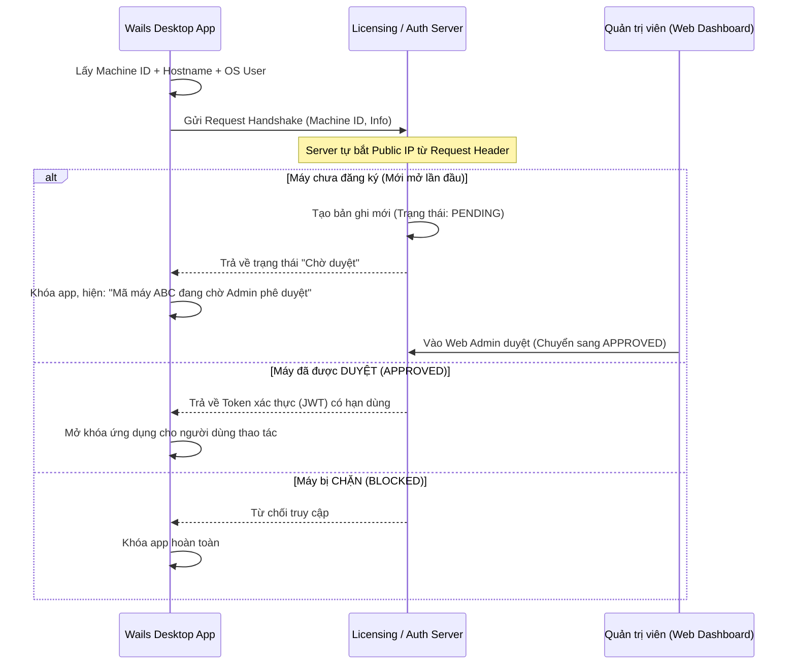

# Đề xuất & Kế hoạch Triển khai: Quản lý & Phê duyệt Quyền Sử dụng Ứng dụng (Machine ID & IP)

Tài liệu này tổng hợp ý tưởng, kiến trúc luồng hoạt động và đề xuất giải pháp máy chủ cho tính năng **xác thực & xét duyệt quyền sử dụng ứng dụng theo thiết bị và địa chỉ IP**.

---

## 1. Lưu ý Cốt lõi về Bản chất của "IP"

Khi kiểm soát quyền truy cập của ứng dụng desktop, cần phân biệt rõ 2 loại IP để tránh bất tiện khi vận hành:

1. **IP Public (WAN IP - Ra ngoài Internet):**
   - **Đặc điểm:** Nếu nhiều máy tính cùng kết nối chung một mạng WiFi / văn phòng, tất cả sẽ có **chung một IP Public** (do kỹ thuật NAT). Ngoài ra, mạng gia đình/4G thường sử dụng **IP động (Dynamic IP)**, sẽ thay đổi sau mỗi lần modem khởi động lại.
   - **Ứng dụng:** Thích hợp khi công ty có **IP Tĩnh (Static IP)** và chính sách yêu cầu người dùng phải kết nối mạng văn phòng hoặc VPN nội bộ mới dùng được app.
2. **IP Private (Local LAN IP - 192.168.x.x, 10.x.x.x):**
   - Chỉ có giá trị trong mạng nội bộ, máy chủ bên ngoài Internet không phân biệt được các thiết bị dựa vào IP này.

> **Giải pháp tối ưu:** Kết hợp **Machine ID (Mã định danh phần cứng)** + **Địa chỉ IP**:
> - Sử dụng **Machine ID / Hardware UUID** (lấy từ CPU, Mainboard, UUID ổ cứng) để định danh chính xác duy nhất từng máy tính.
> - Kèm theo **IP Public/Local** để theo dõi vị trí mạng máy đang kết nối (văn phòng hay bên ngoài).

---

## 2. Kiến trúc & Luồng Hoạt động (Workflow)

### Các bước cụ thể:
1. **Thu thập thông tin phía Client (Wails Go Backend):**
   - Khi app vừa khởi động, tầng backend Go lấy: `Machine UUID`, `Computer Name`, `Windows Username`, `App Version`.
   - Gửi payload đăng ký về Server.
   - *Lưu ý:* Client không cần tự tìm IP Public của mình; khi gửi request lên, máy chủ sẽ tự động đọc IP nguồn từ header (`RemoteAddr` hoặc `X-Forwarded-For`).
2. **Xử lý lưu trữ tại Server:**
   - Lưu trữ bản ghi thiết bị:
     - `machine_id`: Mã định danh phần cứng (Primary Key/Unique)
     - `ip_address`: IP Public gần nhất
     - `hostname`: Tên máy tính
     - `os_user`: Tên tài khoản Windows
     - `status`: `PENDING` (Chờ duyệt) | `APPROVED` (Đã duyệt) | `BLOCKED` (Bị chặn)
     - `first_seen_at`: Thời gian xuất hiện lần đầu
     - `last_active_at`: Thời gian hoạt động gần nhất
3. **Phê duyệt:**
   - Admin truy cập trang Dashboard quản trị, xem danh sách thiết bị đang chờ duyệt.
   - Bấm **"Chấp nhận"** hoặc **"Từ chối"** (có thể phân thêm nhóm quyền hoặc gán ghi chú tên nhân viên sở hữu máy).

---

## 3. Đề xuất Công nghệ Máy chủ (Backend Stack)

| Phương án | Bản chất & Công nghệ | Ưu điểm | Đánh giá |
| :--- | :--- | :--- | :--- |
| **Phương án 1: PocketBase** *(Khuyên dùng nhất)* | Viết bằng **Go**, đóng gói thành **1 file binary duy nhất** (`pocketbase.exe` hoặc Linux binary) kèm sẵn SQLite. | - Có sẵn **Web Admin UI cực đẹp** để admin bấm duyệt ngay, không cần code web admin. - Có sẵn tính năng **Realtime**: Admin bấm Duyệt trên web, app desktop tự mở khóa tức thì. - Cực kỳ nhẹ (~15MB RAM), dùng chung ngôn ngữ Go với dự án Wails hiện tại. | ⭐⭐⭐⭐⭐ **Tối ưu nhất** (Nhanh, gọn, ít tốn công dựng hệ thống) |
| **Phương án 2: BaaS Cloud (Supabase / Firebase)** | Dịch vụ cơ sở dữ liệu trên mây (PostgreSQL/NoSQL). | - Không cần quản lý server/VPS. - Miễn phí gói Free tier. - Có sẵn giao diện quản lý dữ liệu trên trình duyệt. | ⭐⭐⭐⭐ Rất tiện lợi nếu không muốn tự quản lý hạ tầng |
| **Phương án 3: Tự viết REST API** | Viết custom service bằng **Go (Fiber / Gin)** + PostgreSQL / SQLite. | - Toàn quyền tùy biến logic nghiệp vụ sau này (phân quyền tính năng sâu, giới hạn số request/ngày,...). | ⭐⭐⭐ Cần tốn thời gian code cả API lẫn Web Admin cho quản trị viên |

---

## 4. Đề xuất Hạ tầng & Nơi Đặt Máy Chủ (Hosting)

| Loại hạ tầng | Lựa chọn đề xuất | Chi phí ước tính | Phù hợp khi nào |
| :--- | :--- | :--- | :--- |
| **Cloud PaaS (Tiện lợi)** | **Render.com / Railway.app / Fly.io** | Miễn phí hoặc ~$5/tháng | Triển khai nhanh trong vài phút, không cần cấu hình Linux/VPS phức tạp. |
| **VPS Cloud Quốc tế** | **Hetzner / DigitalOcean / Vultr** | ~$4 - $6/tháng | Cần hệ thống ổn định lâu dài, có IP tĩnh riêng. |
| **Cloud trong nước** | **Vietnix / BKNS / Viettel IDC** | ~100k - 150k VNĐ/tháng | Tối ưu đường truyền trong nước, ping cực thấp cho người dùng tại Việt Nam. |
| **Server nội bộ (On-Premise)** | 1 máy PC / Mini PC tại văn phòng | Miễn phí (tận dụng máy sẵn có) | Ứng dụng chỉ sử dụng nội bộ qua mạng LAN văn phòng hoặc VPN công ty. |

---

## 5. Cơ chế Bảo mật & Chống Gian lận (Security)

1. **Xác thực từ phía Máy chủ (Server-side Validation):**
   - Không chỉ chặn ở giao diện khởi động app. Mọi API nghiệp vụ quan trọng mà app gọi tới đều phải kèm theo **Token (JWT)** do máy chủ cấp sau khi đã duyệt thiết bị.
2. **Cơ chế Heartbeat (Nhịp tim định kỳ):**
   - Trong quá trình app đang chạy, định kỳ mỗi 15 - 30 phút app gửi 1 request ping nhẹ về server.
   - Nếu Admin đổi trạng thái sang `BLOCKED`, app sẽ tự động thu hồi phiên làm việc và khóa màn hình ngay lập tức.
3. **Ký số payload (HMAC Signature):**
   - Gói tin handshake gửi từ client lên server có thể được hash kèm 1 secret key để chống việc dùng Postman/curl giả mạo gửi request.
